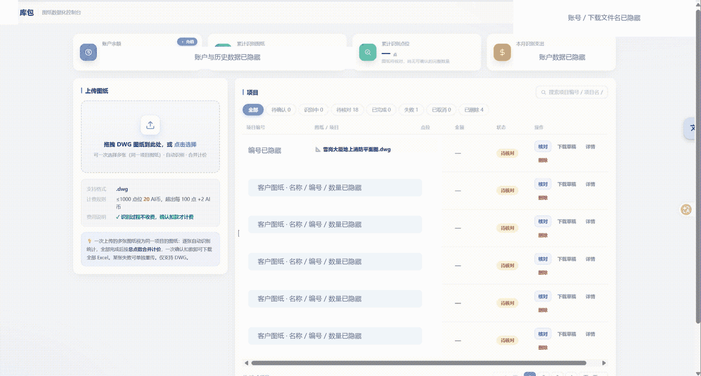
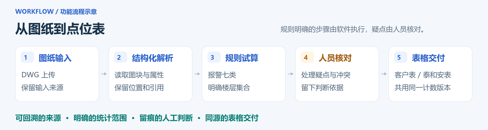

<h1 align="center">COOLBAO｜消防数图工作流</h1>

  <strong>典型小图：人工约 10 分钟 → 软件约 15 秒初步出数。 
  典型大图：人工约 20 分钟 → 软件约 26 秒初步出数。</strong>

  基于 DXF 结构化解析，将 CAD 图纸整理为逐层设备清单。 
  软件完成规则明确的统计，技术人员集中核对疑点，再导出表格。

<table align="center">
  <tr>
    <th align="center">自动统计范围</th>
    <th align="center">人工对照样本</th>
    <th align="center">设备数量统计偏差</th>
  </tr>
  <tr>
    <td align="center"><strong>1 个系统 · 7 类主要设备</strong></td>
    <td align="center"><strong>40 余张图纸</strong></td>
    <td align="center"><strong>5% 以内</strong></td>
  </tr>
</table>

  人工用时含统计及录表；软件计至初步出数，人工复核另计。<a href="docs/performance.md">查看样本与测量口径</a>。

  <a href="#操作演示">操作演示</a> ·
  <a href="#我的产品工作">我的产品工作</a> ·
  <a href="#样本结果">样本结果</a> ·
  <a href="docs/product-case.md">产品设计复盘</a>

## 操作演示

**图纸导入 → 设备统计 → 疑点复核 → 清单导出。** 演示展示上传 DWG、生成逐层统计、下载表格并在 WPS 中查看结果；该图纸初版包含七类设备、2,268 个试算点位，范围与疑点仍需人员核对。

## 我的产品工作

这是我在任职期间推进的企业项目实践。我主导前期 PoC 的需求拆解与流程设计，借助 AI 编码工具推进原型验证，并协同团队完成能力整合与交付。

### 方案取舍

面向可获取 CAD 源文件的数图场景，采用 DXF 结构化解析与规则统计，保留设备属性、位置及来源，支持原图定位与结果复核。首期聚焦火灾报警系统七类主要设备：感烟、感温、手报、消报、声光、扬声器与电话分机，收敛开发与验证范围。

### 流程设计

围绕楼栋、楼层归属与标准层展开设计统计流程，将设备数量组织为技术人员可以逐层核对的清单。客户清单 XLSX 与内部泰和安点位表 XLS 从同一统计版本导出，减少重复录入及修改不同步。

### 异常处理

对设备属性冲突、楼层范围不明、安装形式缺失等情况，提供原图定位、疑点提示和人工修正入口，保留来源与处理依据。未知信息进入待确认，未完成统计时明确显示原因，避免将未知结果计为零。

### 交付推进

将真实人工数图中的设备配置、楼层和录表规则转化为产品要求，与 DXF 团队共同讨论方案和验证方式。在同事已有网站与基础业务框架上，协调推进前端页面与核心功能组件，整合对象追溯、楼层规则、人工复核及两类表格导出，并整理已知问题与交接材料。

协作分工：我负责产品推进、规则梳理及能力整合；同事负责既有网站与基础业务框架；AI 编码工具辅助原型与工程实现。

查看从图纸到表格的处理流程

## 样本结果

基于 **40 余张已完成人工统计的图纸**，对七类设备开展与人工结果对照，当前项目记录中的设备数量统计偏差在 **5% 以内**。

| 典型图纸 | 人工统计及录表 | 软件初步出数 |
| --- | --- | --- |
| 小图 | 约 **10 分钟** | 约 **15 秒** |
| 大图 | 约 **20 分钟** | 约 **26 秒** |

软件用时截至初步出数，后续人工复核另计。上述结果为当前项目样本对照摘要；演示图纸的独立运行记录、测量边界与后续评测项见[效果记录](docs/performance.md)。

---

**继续了解**　[产品设计复盘](docs/product-case.md)：业务问题、方案取舍、异常案例与团队协作 · [效果记录](docs/performance.md)：样本结果与计时口径

本仓库展示产品实践与操作演示，企业源码及原始业务资料独立保管。
